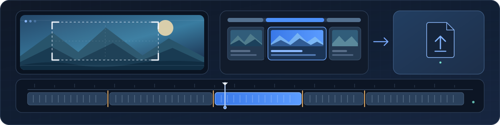
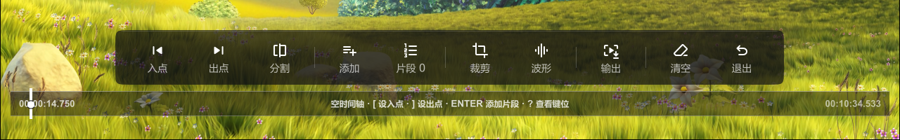
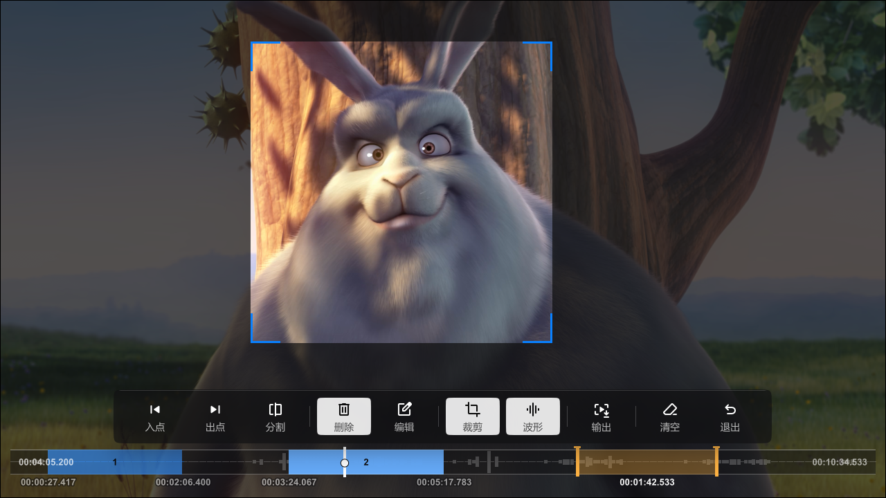
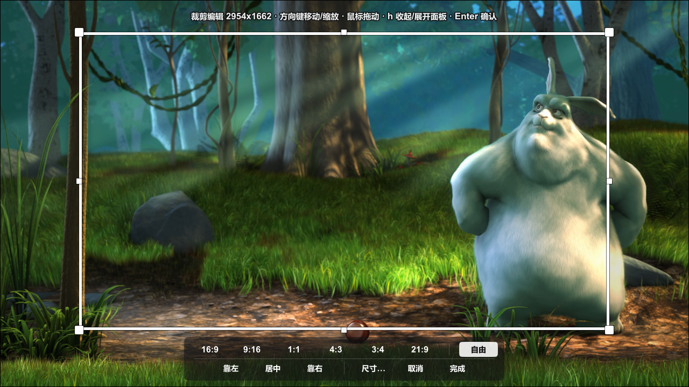
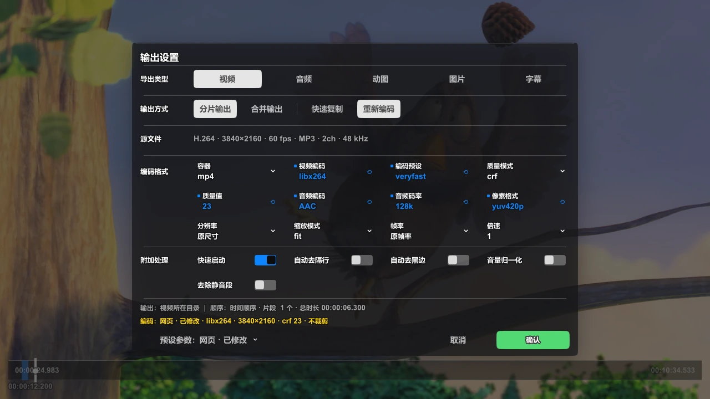

<div align="center">
  <p></p>
  <h1>Quick Cut</h1>
  <p><strong>Edit while you watch. Lightweight, lightning-fast, and seamless mpv video editing.</strong></p>
  <p>No material imports, no software switching, and no manual FFmpeg commands.<br>Cut segments · crop frames · create GIFs · extract audio · convert formats · change speed — all inside your mpv player window.</p>
  <p>
    <a href="README.en.md">English</a> · <a href="README.md">简体中文</a> · <a href="docs/shortcuts.en.md">Keys</a> · <a href="docs/faq.en.md">FAQ</a>
  </p>
  <p>
    <a href="https://mpv.io/"></a>
    <a href="https://ffmpeg.org/"></a>
    <a href="LICENSE"></a>
    
  </p>
  <p><sub>MIT licence · terms in LICENSE govern</sub></p>
</div>

> **Platform**: developed and tested on **Windows** only. macOS / Linux have their platform branches in place but are **not fully tested yet** — reports are welcome.

## Core Features

- ⚡ **Zero Import · Zero Delay**  
  Keep watching while marking in and out points. Supports splitting, deleting, reordering multiple segments, and full Undo/Redo.
- ✂️ **Crop Directly on the Picture**  
  Drag the crop rectangle right on the video (preset ratios like 16:9, 9:16, 4:3, 1:1, or a custom box); the frame and its size update as you drag, and the crop is applied on export.
- 🚀 **Stream Copy, Re-encode When Needed**  
  Changing only in/out points uses stream copy by default, so nothing is re-encoded: usually done in seconds with no loss of original quality; switch to Re-encode when you need filters or frame-exact control, or enable **Remove cut offset** on H.264 sources to snap fast-copy in-points to the frame.
- 🎚️ **Speed Change, Pitch Preserved**  
  With FFmpeg installed, export at 0.25–4× speed; audio keeps its original pitch (no slow-motion rumble or chipmunk vocals) and the output duration scales accordingly.
- 📦 **All-in-One Export & Target File Size**  
  Video, audio, animated GIFs/APNG/WebP, image sequences/contact sheets, and subtitles in one panel. Set a target file size (MB) to calculate matching bitrates automatically.
- 🎬 **Background Rendering & Session Memory**  
  Exports run asynchronously in the background without interrupting video playback. Editing progress is automatically remembered per file and restored when reopened.
- 🧰 **Fully Portable · Zero Footprint**  
  Requires only mpv itself — ffmpeg / ffprobe unlock the full feature set, and a reduced export still works without them. Drop the folder into `scripts/` and run anywhere, even from a USB drive. Fully offline, zero telemetry, preserving your OSC, `input.conf`, and playback habits.

## A good fit, and not

- **Good for**: trimming, cropping and gathering material; GIFs / animated images for chats and posts; stream-copy exports that only move in and out points; lightweight setups, portable drives, or machines where you would rather not install another big program.
- **Not intended for**: multi-track editing, colour grading, effects or subtitle burn-in; complex timeline editing or keyframe animation; batch or productionised editing pipelines. Use a dedicated editor for those.

---

## Interface preview

**Editor**



**Editing session**



| Crop window | Export panel |
| :---: | :---: |
|  |  |

> **Demo footage**: the film frames in the screenshots come from the open-source movie [Big Buck Bunny](https://peach.blender.org/) (© Blender Foundation, [CC BY 3.0](https://creativecommons.org/licenses/by/3.0/)), **not from this project**, and are used for UI demonstration only.

---

## Quick start

### Requirements

| Requirement | Version | Notes |
| :--- | :--- | :--- |
| **mpv** | ≥ 0.38 | custom input fields need `mp.input` (available since 0.38.0); older builds still load the script, but features that rely on an input box (typing a timecode, custom parameter values, …) are disabled with a hint, and the "custom…" entry disappears from parameter menus. Works with mpv's own OSC and with uosc |
| **ffmpeg / ffprobe** | ≥ 5.1 (optional) | avif muxing and jxl encoding are available since 5.1; when the build lacks libaom / libjxl those formats are hidden from the menu. **Installing it is optional**: without it the script falls back to mpv's built-in encoders for a reduced export, see below |

With bare `ffmpeg=` / `ffprobe=` values the script searches `PATH` first, then the script folder and its parents (including their `bin\` subfolders), then common install locations; for portable setups, placing `ffmpeg.exe` in the mpv folder or under `portable_config` is enough.

#### Export capabilities without ffmpeg

mpv statically links libavcodec / libavformat, so the script can use it as a backup encoder. Exports still work without ffmpeg, but only for the "re-encode everything" family:

| Capability | With ffmpeg | mpv only |
| :--- | :---: | :--- |
| Re-encoded video export (mp4 / mkv / mov / ts / webm) | ✅ | ✅ |
| Audio extraction (m4a / mp3 / flac / wav / opus / ogg) | ✅ | ✅ |
| Image sequences (png / jpg / webp) | ✅ | ✅ |
| Animated images (gif / webp / apng) | ✅ | ✅ |
| Fast copy (lossless, instant) | ✅ | ❌ mpv has no copy codec, it switches to re-encoding |
| Remove cut offset | ✅ | ❌ needs stream copy and concat |
| Merge export | ✅ | ❌ same reason |
| Subtitle export | ✅ | ❌ mpv cannot export subtitle tracks |
| Image tile / single frame | ✅ | ❌ sequence mode only |
| Two-pass size-limited encoding | ✅ | ❌ degrades to single-pass target bitrate, size not guaranteed |
| Speed change | ✅ | ❌ encode mode cannot rewrite the timeline (see the [FAQ](docs/faq.en.md)) |

Without ffmpeg the unsupported items are greyed out with a stated reason (see the [FAQ](docs/faq.en.md) for how the panel behaves).

Install ffmpeg when you want the full feature set; the script prefers it automatically. An mpv instance that is already running must be restarted before it re-detects ffmpeg.

### Get it

- **Release package**: grab the latest `quick_cut_v1.0.7z` from [Releases](https://github.com/wha4up/quick_cut/releases) and unpack it — you get the `quick_cut` folder, `script-opts/quick_cut.conf`, and three license files (`LICENSE`, `LICENSES/Apache-2.0.txt`, `权利声明.md`). The archive carries only what is needed to run; docs and screenshots live in the repo;
- **Clone the repo**: take the `scripts/quick_cut` folder (`release/` is not in the repo — it is just the packaging mirror).

### Install the script

Put the whole `quick_cut` folder into mpv's `scripts/` directory (mpv loads its `main.lua` automatically):

- **Portable mode**: `<mpv.exe folder>\portable_config\scripts\quick_cut\`
- **Regular mode**: `%APPDATA%\mpv\scripts\quick_cut\` (macOS / Linux: `scripts/` inside the mpv config directory)

### Open the editor

Pick the way that matches your interface, then restart mpv and play a video to enter the editing deck:

- **uosc**: add `button:quick_cut` to `controls=` in `script-opts/uosc.conf`, wherever you want it:

  ```conf
  controls=menu,gap,subtitles,...,button:quick_cut,gap,space,speed,...
  ```

  The script supplies the button's look and action through uosc's `set-button` interface (icon `cut`, tooltip "Open Quick Cut"); all you do is reserve a slot in `controls=`. `controls=` is a flat list — `space` is what actually splits it into left and right groups, so put it before the first `space` for the left group, or after it for the right.

- **mpv's own OSC, ModernZ, …**: these have no custom-button interface, so add a key to your `input.conf`:

  ```conf
  c   script-binding quick_cut/cut_menu
  ```

  The equivalent form is `c script-message toggle_studio_mode`. uosc is entirely optional.

### Editing flow

1. `[` / `]` set the in and out points, `ENTER` adds the segment;
2. `e` opens the export panel — pick a type and its parameters;
3. press `ENTER` again to start.

Exports run in the background without interrupting playback; when only in / out points change, fast copy (stream copy) is selected by default — without ffmpeg it falls back to re-encoding automatically.

### Change defaults (optional)

Copy `script-opts/quick_cut.conf` into mpv's `script-opts/` directory and edit that copy (do not edit the one inside the script folder):

- **Portable mode**: `<mpv.exe folder>\portable_config\script-opts\quick_cut.conf`
- **Regular mode**: `%APPDATA%\mpv\script-opts\quick_cut.conf`

---

## How it works

### Editing

Arranging segments and previewing them in the editor.

- **Segments**: in / out points, split at the playhead, delete, reorder, or type a timecode directly; `Alt+←/→` jumps to the previous / next keyframe (marks are not snapped to keyframes).
- **Undo / redo**: segments and crop share one history (`z` / `y`); it also works while cropping, and one drag counts as one step.
- **Playback**: loop a single A-B range or play segments in sequence; free playback is restored on exit.
- **Waveform**: `w` draws the audio waveform behind the timeline (scanned on demand, off by default).
- **Panel and key reference**: `?` shows the keys for the current context; `h` collapses the button panel (timeline and picture stay, keys keep working).

### Cropping

- Fixed ratios (16:9 / 9:16 / 4:3 / 1:1 / 21:9 …) or a custom rectangle, applied on export;
- The mask and size label update while you drag; the picture itself is not cropped live.

### Session memory

Progress is recorded per file in `quick_cut_sessions.json` next to the script and restored the next time you open the same file; set `resume_session` to `no` to turn it off. This is the script's own state record, unrelated to exports — see the [FAQ](docs/faq.en.md) for where it lives and how to clear it.

---

## Export

The export panel reads top to bottom as four blocks: **export type** → **output mode** → **encoding format** → **automatic passes**, with the preset menu and the action buttons at the bottom. This section follows that order.

### Export type

| Type | Notes |
| :--- | :--- |
| **Video** | fast copy or re-encode; set the audio codec to "No audio" to export a silent video |
| **Audio** | audio track only: m4a / mp3 / opus / flac / wav / ogg |
| **Animated image** | gif / webp / apng / avif, with fps, width, loop count and quality |
| **Image** | frame sequence / keyframes (decode keyframes only, faster) / tile overview / single frame per segment; formats png / jpg / webp / avif / jxl / tiff |
| **Subtitle** | the currently selected subtitle track only: srt / ass / webvtt, or `copy` (image subtitles such as PGS need `copy`) |

### Output mode

One row, two independent choices: **separate / merge** decides how many files you get, **fast copy / re-encode** decides how they are produced.

| Option | Meaning |
| :--- | :--- |
| **Separate files** | one file per segment |
| **Merge** | joins every segment, in list order, into one file (`m` goes straight there); subtitles cannot be merged, images only in tile mode with a single segment |
| **Fast copy** | streams are copied and re-muxed — seconds, no quality loss; in-points are limited by keyframe positions |
| **Re-encode** | the whole selection is re-encoded: frame-exact in-points and every encoding parameter available |

Anything that needs a filter, a parameter change or a speed change switches the mode to re-encode, and fast copy becomes unavailable.

### Encoding format

A parameter grid; listed here in panel order, left to right, top to bottom:

| Parameter | Effect |
| :--- | :--- |
| **Container** | mp4 / mkv / mov / webm / ts. Switching to a container that accepts the source codecs finishes in seconds without loss; otherwise it re-encodes automatically |
| **Video codec** | H.264 / H.265 / VP9 / AV1, hardware encoders included; `copy` passes the source stream through |
| **Encoder preset** | speed/efficiency trade-off of the encoder — faster means larger files |
| **Quality mode** | `crf` constant quality / `cq` constant quantiser / `global_quality` / `bitrate` fixed rate |
| **Quality value** | depends on the mode: lower CRF means higher quality; bitrate mode takes the target bitrate |
| **Audio codec** | AAC / MP3 / Opus / FLAC; `copy` passes the source through, "No audio" exports a silent video |
| **Audio bitrate** | 96k / 128k / 192k / 256k / 320k |
| **Pixel format** | yuv420p is the most compatible; 10-bit / 4:2:2 / 4:4:4 need a player that supports them |
| **Resolution** | source size or an explicit width and height |
| **Scaling mode** | fit (keep ratio) / pad (add bars) / stretch |
| **Frame rate** | source rate or an explicit value |
| **Speed** | 0.25–4×; the video timeline and the audio duration scale together, and audio keeps its pitch through an `atempo` chain. Mutually exclusive with fast copy — any non-1× speed switches to re-encode |

With fast copy selected for video, this whole block collapses into a single line: stream copy has no encoding parameters to tune.

### Automatic passes

The source is probed asynchronously before export; a probe failure only logs a warning and never blocks the job.

| Toggle | Effect |
| :--- | :--- |
| **Fast start** | moves the index to the start of the file so it can play while downloading; only shown for mp4 / mov, never changes quality |
| **Remove cut offset** | makes fast-copy in-points frame-exact instead of snapping to the previous keyframe, at the cost of one very short local re-encode of the opening GOP (h264 sources only) |
| **Auto deinterlace** | inserts a deinterlacing filter when the source is interlaced (old recordings, DVD) |
| **Auto crop black bars** | runs `cropdetect` over the head of the source and applies the detected rectangle (manual crop wins) |
| **Loudness normalisation** | two-pass `loudnorm` to the target loudness (audio is re-encoded, video can still be stream copied) |
| **Silence removal** | removes silent sections from the selection (re-encode required) |

Under fast copy only **Fast start** and **Remove cut offset** remain: every other toggle introduces a filter, and filters require re-encoding.

### Presets and target size

The menu at the bottom left retunes the whole parameter set at once; the two entry points are mutually exclusive:

- **Presets** — built-in "Original" (follows the source file) / "Web" / "High quality" / "Archive", plus custom presets in the conf (e.g. NVENC); you can also save the current parameters as your own preset.
- **Optimisation goals** — quality / speed / smallest loss / target size. After choosing a target size, enter the size in MB (default 50): the script derives the bitrate from the **total duration** of the selection (`size × 8388.608 ÷ duration`, minus roughly 2% + 0.5 MiB of container overhead) and forces re-encode. A target that is too small (below the floor for that resolution, minimum 16 kbps), above the source bitrate or far outside the sensible range is explained and pre-filled — press ENTER once more to proceed.

### Output naming

- **Default**: `<source>_<index>_<in>-<out>_cut` (a renamed segment uses its custom name instead of the timecodes).
- **Custom template**: set `output_name_template` in the conf, with `{name}`, `{index}`, `{in}` and `{out}`; it only applies to **unnamed** segments and suppresses the `_cut` suffix.
- **Image additions**: single frames append `_frame`, tiles append `_sheet`, image sequences append a `_%04d` frame number (e.g. `my_video_002_0001.png`).

---

## Keys

| Key | Action | Key | Action |
| :--- | :--- | :--- | :--- |
| `SPACE` | play / pause | `[` / `]` | set in / out point |
| `ENTER` | add segment / save edit | `s` | split at playhead |
| `z` / `y` | undo / redo | `e` | open the export panel |
| `c` | open the crop window | `?` | key reference for the current panel |

Every **keyboard** key can be changed in `script-opts/quick_cut.conf` (`key_*` / `crop_key_*`); separate multiple keys with commas, leave the field blank to disable. The left mouse button is taken over by the script inside the editor (clicking the picture clears the selection); the wheel is only captured while the pointer is over the panel / segment list or while a dropdown in the confirm panel is expanded — the rest of the time it stays with mpv, so a wheel volume binding set through `extra_bindings` keeps working. The full key list is in [the complete key list](docs/shortcuts.en.md).

## Look and personalisation

The look is controlled by built-in constants (tokens live in `core/ui.lua`'s `DEFAULT_TOKENS`); the icons are glyphs of a bundled icon font (`fonts/Quickcut_icons.ttf`). If the icons are missing and buttons show text only, see the [FAQ](docs/faq.en.md).

- **Appearance overrides**: use the conf options `ui_color_*`, `ui_alpha_*`, `ui_radius_*` and `ui_layout_*` for colours, alphas, radii and geometry (read at startup only — restart mpv after editing).
- **Unavailable-item style**: `ui_button_disabled_style` accepts `strike` (default), `slash`, `strike_slash` or `dim`; tune it with `ui_alpha_button_disabled` (0–1, default 0.42) and `ui_layout_button_disabled_strike` (line width 1–6, default 2).
- **UI scale presets**: `ui_preset` = `comfortable` / `compact` / `ultra_compact` / `custom`, handy on small windows or in floating windows.
- **Precedence**: explicit conf item > explicit preset > built-in default. The command line can override temporarily, e.g. `--script-opts=quick_cut-scale=1.25`.

---

## FAQ

UI icons, export speed, audio-track compatibility, session storage, the scope of undo / redo, why player-side shaders / filters never reach the output, what still works without ffmpeg, and how speed change is applied — see the [FAQ](docs/faq.en.md).

---

## License

This project is released under the **[MIT License](LICENSE)**, which permits use, copying, modification, redistribution and sublicensing of the software, free of charge or for a fee, including commercial use, paid products and closed-source integration. When redistributing the software or a substantial portion of it, keep the copyright notice and the permission notice as required by the licence.

The English text in [`LICENSE`](LICENSE) governs. This summary adds no conditions beyond the MIT License; third-party notices and the AI-assisted development statement are in [`权利声明.md`](权利声明.md).

---

## Credits

- [mpv](https://mpv.io/) — the Lua scripting interface and all playback capability;
- [ffmpeg / ffprobe](https://ffmpeg.org/) — when installed, all transcoding, probing, thumbnails and progress parsing is done by it (invoked as a separate program, not distributed with this project); without it mpv's own encoders take over;
- [uosc](https://github.com/tomasklaen/uosc) — third-party OSC; the script registers a control-bar button with it (you add `button:quick_cut` to `controls=` yourself; works without it too);
- [Material Symbols](https://fonts.google.com/icons) — design source of the UI icon glyphs (Apache License 2.0); renamed, adapted and packed into `fonts/Quickcut_icons.ttf` by this project;
- [Big Buck Bunny](https://peach.blender.org/) — the test footage used in the screenshots (© Blender Foundation, CC BY 3.0);
- [DeepSeek](https://www.deepseek.com/) — the AI coding assistant used during development, which helped generate parts of the code; project direction, feature decisions, review, modification and integration were led by the author. See [`权利声明.md`](权利声明.md).
